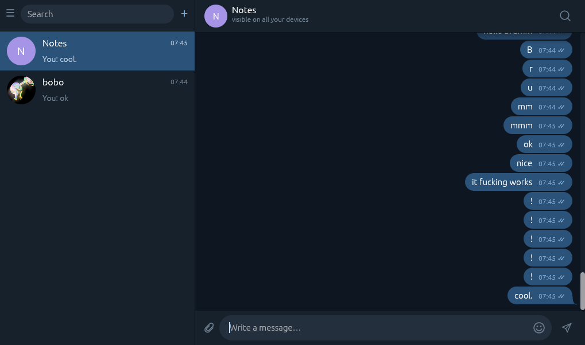

# brumm



A fun, secure and decentralized messenger: no phone number, no account server.
Devices talk **directly peer-to-peer** ([iroh](https://github.com/n0-computer/iroh)), everything is
**end-to-end encrypted** (Olm double ratchet via [vodozemac](https://github.com/matrix-org/vodozemac)),
and when a device is offline its messages wait encrypted on **public Nostr relays**.

> ⚠️ **Pre-release.** The protocol and storage format still change without migrations, and the local
> database is not encrypted at rest yet. Don't use it for anything sensitive.

## Features (so far)
- **Identity from a 24-word seed phrase.** No phone number, email or server account.
- **Add contacts** with a single-use invite link or QR code.
- **1:1 chats** with end-to-end encryption. Profiles and device lists are encrypted too.
- **Multi-device**: link a new device with a link or QR code. It receives your contacts and the last 60 days of chats.
  You can remove lost devices.
- **Offline delivery** through public Nostr relays (no own server). Letters are signed by throwaway keys and
  encrypted with NIP-44, so relays learn neither who is talking nor what is said.
  Statuses: 🕓 pending → ✔ sent (in the mailbox) → ✔✔ delivered.
- **Groups** of up to 10 000 members without a server: owner, admins and members, announcement mode, invitations,
  kicking with a fresh group key, optional shared history for newcomers. Messages spread peer-to-peer (iroh-gossip),
  members serve the group's log to each other, and Nostr relays carry what nobody online received.

## Clients
- **Desktop app** (Linux, macOS, Windows) built with [egui](https://github.com/emilk/egui).
- **Web client**: the same egui UI in the browser, optimized for mobile (single-pane chat list / chat,
  touch-friendly composer, on-screen keyboard aware). The core runs in a Web Worker and stores data in the
  browser's private storage (OPFS); it connects through iroh relays only.
  Build with `(cd crates/brumm-app && trunk serve)`.

Planned: offline invites and contact introductions, stickers, native mobile apps,
Bluetooth/Wi‑Fi mesh. See [SPEC.md](SPEC.md) for the full design and milestones.

## Run
Requires Rust (stable, edition 2024).
```sh
cargo run --release                                    # default profile
cargo run --release -- --profile alice                 # separate identity per profile,
cargo run --release -- --profile bob                   # e.g. to chat with yourself locally
```
Profile data lives in `~/.local/share/brumm/profiles/<profile>/` (Linux).

Desktop integration (taskbar icon and app grid entry on Wayland/GNOME):
```sh
cargo build --release
scripts/install-desktop.sh      # -> ~/.local/share/{applications,icons/hicolor/256x256}, ~/.local/bin/brumm
```
Wayland compositors ignore window icons set by the client: they match the window's `app_id` against an
installed `brumm.desktop` and take its `Icon=`. Running straight from `target/` therefore shows the
generic icon until the entry and icon are installed.

## Test
```sh
cargo test                                                    # unit + local end-to-end (incl. in-memory Nostr relay)
cargo test -p brumm-core --test network -- --ignored          # needs internet: iroh relays, DNS discovery, public Nostr relays
```

## Layout
```
crates/brumm-core   protocol, crypto, storage, networking (no UI) — talks to UIs via Command/Event
crates/brumm-worker browser only: runs brumm-core in a Web Worker
crates/brumm-app    egui app (desktop + web)
SPEC.md             protocol + architecture specification
```

## License
Licensed under either of [Apache License, Version 2.0](LICENSE-APACHE) or [MIT license](LICENSE-MIT)
at your option. Unless you explicitly state otherwise, any contribution intentionally submitted for
inclusion in this work, as defined in the Apache-2.0 license, shall be dual licensed as above, without
any additional terms or conditions.
